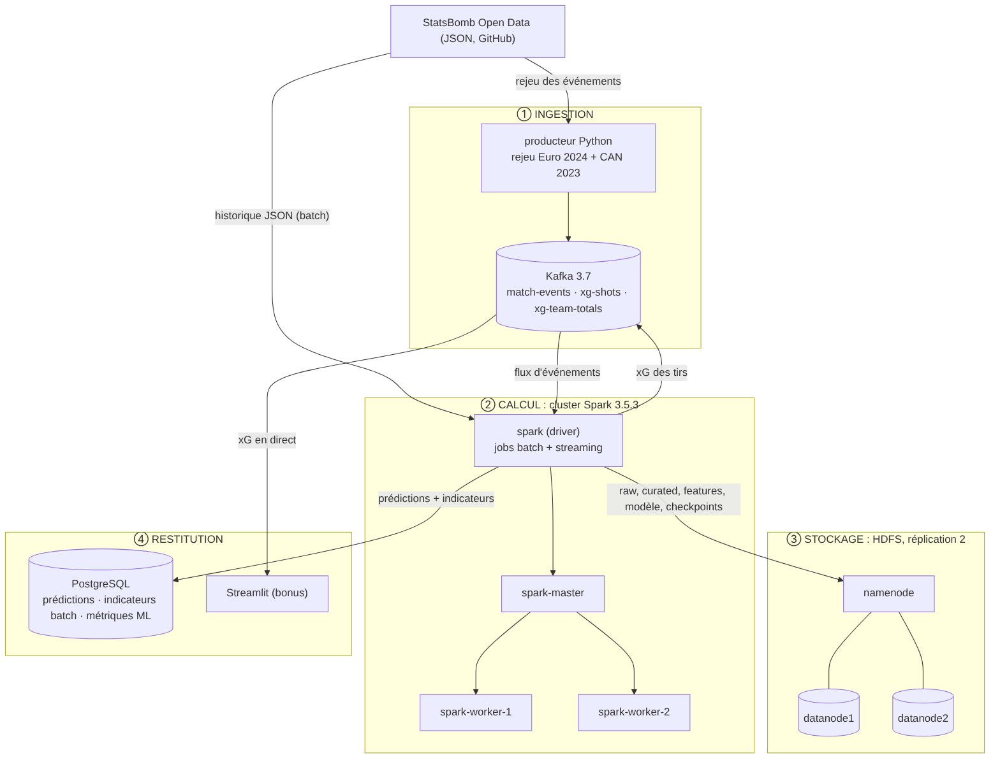

# xG en direct - Projet Big Data (Plateformes et Analytics)

Modèle d'expected goals (xG) entraîné en batch sur StatsBomb Open Data, puis déployé sur un flux Kafka de matchs rejoués (Euro 2024, CAN 2023). Sujet, dataset et tâche ML : [docs/livrable1.md](docs/livrable1.md). Architecture détaillée : [docs/architecture.md](docs/architecture.md).



## Cluster Docker

| Service | Rôle | Port hôte |
| --- | --- | --- |
| `namenode` | HDFS : métadonnées (volume `nn-data`) | 9870 |
| `datanode1`, `datanode2` | HDFS : blocs, **réplication 2** (volumes `dn1-data`, `dn2-data`) | — |
| `spark-master` | Master du cluster Spark standalone | 8090 (UI), 7077 |
| `spark-worker-1`, `spark-worker-2` | Workers (2 cœurs, 2 Go chacun, réglable dans `.env`) | 8081, 8082 |
| `spark` | Driver : lance les jobs (`make <job>`), mode client | 4040 (UI du job) |
| `kafka` | Broker Kafka (mode KRaft), 3 partitions par topic | 29092 |
| `postgres` | Base de restitution (volume `pgdata`) | 5432 |
| `dashboard` | Streamlit (bonus) + producteur de rejeu | 8501 |

Tous les jobs Spark s'exécutent sur le cluster (`SPARK_MASTER=spark://spark-master:7077`).

## Couches du projet

| Couche | Outil | Code |
| --- | --- | --- |
| Ingestion batch | Spark → HDFS | `ingestion/01_ingest_batch.py` |
| Ingestion streaming | Producteur Python → Kafka | `ingestion/replay.py` |
| Stockage (voie froide) | HDFS (`/raw`, `/curated`, `/features`, `/models`, `/serving`) | `batch/` |
| Traitement | Spark Core (RDD `wholeTextFiles`) | `batch/02_process_events.py` |
| Analytique | Spark SQL + Spark ML | `batch/03_build_shots.py`, `batch/04_train.py` |
| Streaming (voie chaude) | Kafka → Structured Streaming → modèle chargé au démarrage | `streaming/05_stream_xg.py` |
| Restitution | PostgreSQL (+ Streamlit en bonus) | `xg/db.py`, `dashboard/app.py` |

Les variables du modèle sont calculées par une seule fonction, `xg/features.py`, utilisée à l'identique par le batch et par le streaming.

## Prérequis

- Docker avec Docker Compose v2 ; **10 Go de RAM** alloués à Docker (8 Go possible en baissant `WORKER_MEMORY=1g`, `EXECUTOR_MEMORY=512m`, `DRIVER_MEMORY=1g` dans `.env`).
- `git` et `make` sur la machine hôte.
- Internet au premier lancement : images Docker, clone StatsBomb (`make data`), connecteur Kafka de Spark (Maven, `make stream`).
- Mac Apple Silicon : les images `apache/hadoop` tournent en émulation amd64 (plus lent, fonctionnel).

## Démarrage

```bash
make data      # clone partiel StatsBomb dans ./data (une seule fois)
make up        # crée .env si absent, puis docker compose up -d --build
make status    # vérifie : "Live datanodes (2)" ; workers sur http://localhost:8090
make topics    # topics Kafka
make batch     # ingest -> process -> shots -> train (le plus long : train)
make stream    # terminal 1 : laisse tourner le streaming
make replay    # terminal 2 : rejoue les matchs (SPEED=60 par défaut, MATCH=<id> pour un seul)
```

Changer `POSTGRES_PASSWORD` dans `.env` avant `make up` (le fichier `.env` n'est jamais versionné ; `.env.example` sert de modèle). `make help` liste toutes les commandes, `make test` lance les tests unitaires.

Accès : dashboard http://localhost:8501 · HDFS http://localhost:9870 · cluster Spark http://localhost:8090 · base `make psql`.

## Ce que produit chaque étape

| Étape | Sortie |
| --- | --- |
| `make ingest` | JSON brut dans `hdfs:///raw/statsbomb` (matchs de rejeu exclus) |
| `make process` | `hdfs:///curated/events` et `hdfs:///curated/matches` (Parquet, colonne `split`) |
| `make shots` | `hdfs:///features/shots` + tables PostgreSQL `batch_split_summary`, `batch_competition_summary`, `batch_goal_rate_by_distance` |
| `make train` | `hdfs:///models/xg_best`, `/serving/metrics.json`, tables `model_metrics` et `classification_metrics` (matrices de confusion, précision, rappel, F1) |
| `make stream` | topics `xg-shots`, `xg-team-totals`, archive `hdfs:///serving/stream_shots`, table `shot_predictions` |

Requêtes utiles : `SELECT * FROM team_totals;` · `SELECT * FROM stream_latency;` (délai Kafka → base) · `SELECT * FROM model_metrics;`

## Vérifier la reprise après arrêt

1. `make stream` + `make replay`, laisser quelques matchs passer.
2. Arrêter `make stream` (Ctrl+C), puis le relancer : Spark reprend aux offsets du checkpoint (`hdfs:///checkpoints`).
3. Les écritures PostgreSQL sont idempotentes (`ON CONFLICT (id)`) : aucun tir n'est dupliqué.

## Points d'attention

- **Persistance** : HDFS et PostgreSQL ont des volumes nommés, conservés par `make down`. `docker compose down -v` efface tout (il faut alors refaire `make batch`).
- **Rejouer depuis zéro** : `make reset-stream` (efface checkpoints, archive HDFS et table `shot_predictions`), puis `make stream` et `make replay`.
- **Score affiché** : calculé à partir des tirs ; les buts contre son camp ne sont pas comptés.
- **Reproductibilité** : `make data` écrit le commit utilisé dans `data/STATSBOMB_COMMIT`. Pour figer une version : `STATSBOMB_REF=<sha> make data`.
- **Versions** : Spark 3.5.3 (PySpark), Kafka 3.7.0, Hadoop 3.3.5, PostgreSQL 16.4, Streamlit 1.40.x, Python 3.11.
- **Statut des tests** : tests unitaires OK ; couche base de données et mode cluster Spark vérifiés sur un master + 2 workers et un PostgreSQL réels. Le déploiement Docker complet reste à valider par une première exécution (`make up` puis `make batch`).

## Données

[StatsBomb Open Data](https://github.com/hudl/open-data). Toute publication des résultats doit citer StatsBomb comme source et utiliser son logo.
