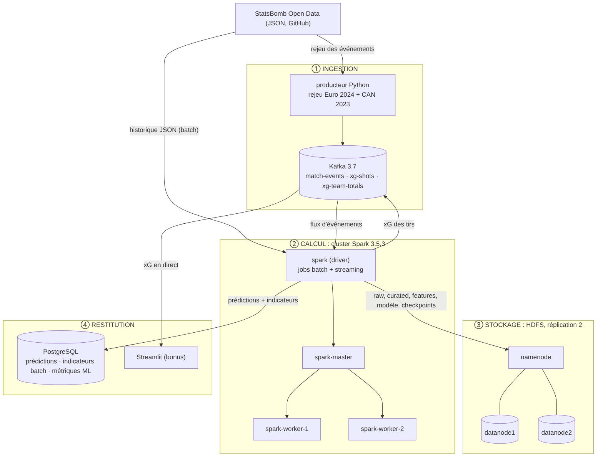

# Architecture

Source du schéma : [architecture.mmd](architecture.mmd) (Mermaid).

## Flux

| # | Flux | Détail |
| --- | --- | --- |
| 1 | StatsBomb → HDFS (batch) | `ingestion/01_ingest_batch.py` copie le JSON brut (hors matchs de rejeu) dans `/raw`. |
| 2 | HDFS → HDFS (batch) | `batch/02` (Spark Core) puis `batch/03` (Spark SQL) produisent `/curated` puis `/features` en Parquet. |
| 3 | HDFS → modèle (batch) | `batch/04_train.py` : 4 modèles, validation croisée, test ; sauvegarde du `PipelineModel` dans `/models/xg_best`. |
| 4 | StatsBomb → Kafka | `ingestion/replay.py` rejoue les matchs dans le topic `match-events`. |
| 5 | Kafka → Spark → Kafka / HDFS / PostgreSQL | `streaming/05_stream_xg.py` charge le modèle au démarrage et prédit l'xG de chaque tir. |
| 6 | Restitution | PostgreSQL (prédictions, indicateurs batch, métriques ML) ; Streamlit lit Kafka et `/serving`. |

## Ressources (valeurs par défaut de `.env`)

| Élément | Valeur |
| --- | --- |
| Workers Spark | 2 × (2 cœurs, 2 Go) |
| Executors | 2 cœurs, 1 Go chacun ; 4 cœurs au total (`TOTAL_CORES`) |
| Driver | 2 Go (`DRIVER_MEMORY`) |
| HDFS | 1 NameNode, 2 DataNodes, réplication 2 |
| Docker | 10 Go de RAM conseillés |
