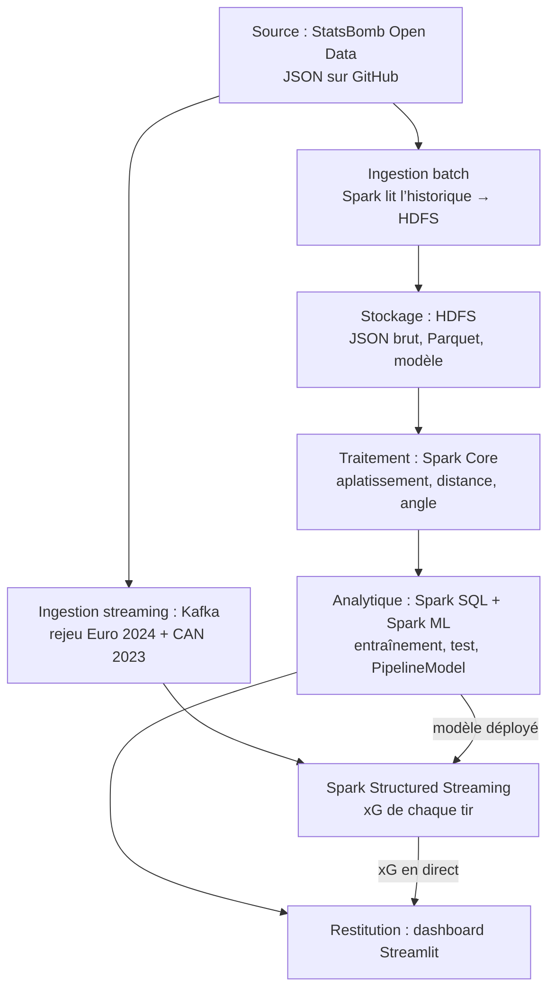

# Livrable 1 — Projet Big Data Analytics

17 octobre 2026

Estimer en temps réel la probabilité qu’un tir finisse en but (expected goals, xG) à partir des données événementielles ouvertes de StatsBomb, avec un modèle Spark ML entraîné en batch puis déployé sur un flux Kafka de matchs rejoués.

## Groupe

Groupe de 4 personnes, une couche de l’architecture par responsable ; le modèle ML est porté collectivement.

| Membre | Responsabilité principale |
| --- | --- |
| Younes Boudali | Ingestion streaming : producteur Kafka + Spark Structured Streaming |
| Membre 2 (à compléter) | Ingestion batch + stockage HDFS + traitement Spark Core |
| Membre 3 (à compléter) | Couche analytique : Spark SQL + pipeline Spark ML |
| Membre 4 (à compléter) | Restitution : dashboard Streamlit |

## Sujet

**Titre :** Expected Goals (xG) en temps réel — probabilité de but de chaque tir pendant un match.

**Problématique :** au moment où un joueur tire, quelle est la probabilité que le tir finisse au fond, compte tenu de sa position, du type de tir et de la situation de jeu ? L’xG est la métrique de référence de l’analyse football, utilisée par les clubs et affichée en direct à la télévision.

**Pourquoi ce sujet colle au projet :**

- Un match est une suite d’événements horodatés (passes, tirs, pressions…) : on peut le rejouer dans Kafka comme un match en direct.
- L’historique (environ 80 couples compétition-saison) sert au batch ; des tournois récents sont mis de côté pour le streaming.
- StatsBomb fournit son propre xG (`statsbomb_xg`) : une référence professionnelle pour juger notre modèle.
- La restitution est naturelle : courbe d’xG cumulé par équipe en direct et carte des tirs.

## Dataset

**StatsBomb Open Data** : données événementielles de matchs (chaque passe, tir, pression… avec coordonnées sur le terrain), en JSON, gratuites, publiées sur GitHub ([dépôt hudl/open-data](https://github.com/hudl/open-data)).

| Élément | Valeur |
| --- | --- |
| Source | StatsBomb (Hudl), dépôt GitHub public |
| Format | JSON : `competitions.json`, `matches/{competition_id}/{season_id}.json`, `events/{match_id}.json`, `lineups/{match_id}.json`, `three-sixty/{match_id}.json` |
| Couverture | environ 80 couples compétition-saison ([competitions.json](https://github.com/hudl/open-data/blob/master/data/competitions.json)) : Coupes du monde 2018 et 2022, Euro 2020 et 2024, CAN 2023, Copa América 2024, Bundesliga 2023/2024, Ligue 1 2021/2022 et 2022/2023, La Liga (matchs de Messi au Barça), compétitions féminines… |
| Volume | ≈ 5 Go dès août 2022 ([floodlight](https://floodlight.readthedocs.io/en/latest/modules/io/datasets.html)), enrichi depuis ; plusieurs millions d’événements — le comptage exact est la première tâche de l’ingestion |
| Granularité | 1 ligne = 1 événement de match ; table ML = 1 ligne par tir |
| Repère terrain | 120 × 80 ; but attaqué en x = 120, poteaux en y = 36 et y = 44 |
| Conditions | Usage libre pour la recherche ; citer StatsBomb (et son logo) en cas de publication |

**Champs utiles d’un tir :** `location` \[x, y\], `shot.body_part`, `shot.type`, `shot.technique`, `shot.first_time`, `shot.one_on_one`, `under_pressure`, `play_pattern`, `shot.freeze_frame` (positions des joueurs au moment du tir), `shot.outcome` (cible), `shot.statsbomb_xg` (référence), `shot.end_location`.

**Découpage par match (aucun match partagé entre phases) :**

| Usage | Données |
| --- | --- |
| Entraînement (batch) | Toutes les compétitions masculines non listées ci-dessous |
| Test (batch) | Bundesliga 2023/2024 + Copa América 2024 |
| Rejeu temps réel (streaming) | UEFA Euro 2024 + CAN 2023 (dont les matchs du Maroc) |

## Tâche ML

**Classification binaire supervisée :** pour chaque tir, prédire `but` = 1 si `shot.outcome` vaut « Goal », sinon 0. La probabilité prédite est l’xG du tir.

**Règle anti-fuite :** n’entre dans le modèle que ce qui est connu au moment de la frappe. Tout ce qui décrit la suite du tir est exclu.

| Variable | Statut | Raison |
| --- | --- | --- |
| Distance au centre du but (depuis `location`) | Créée | Premier facteur de l’xG |
| Angle sous lequel le tireur voit les deux poteaux (depuis `location`) | Créée | Un tir excentré voit moins de cage |
| `shot.body_part`, `shot.type`, `shot.technique` | Gardée | Connus à la frappe |
| `shot.first_time`, `shot.one_on_one`, `under_pressure` (absent → faux) | Gardée | Contexte de la frappe |
| `play_pattern` (contre-attaque, corner, coup franc…) | Gardée | Phase de jeu qui précède le tir |
| Défenseurs entre le tireur et le but, position du gardien (depuis `shot.freeze_frame`, si présent) | Créée | Densité défensive au moment du tir |
| `shot.outcome` | Cible | — |
| `shot.statsbomb_xg` | Exclue | xG de StatsBomb : sert de référence de comparaison, jamais d’entrée |
| `shot.end_location`, `shot.deflected`, `shot.saved_to_post`, `shot.saved_off_target` | Exclue | Décrivent ce qui se passe après la frappe |

**Nettoyage :** compétitions masculines uniquement ; penalties exclus du modèle (on leur attribue le taux de réussite historique des penalties du jeu d’entraînement) ; tirs sans `location` retirés.

**Déséquilibre :** les buts sont minoritaires (ordre de grandeur 10 % des tirs, à mesurer à l’exploration). Pas de rééquilibrage des classes : il fausserait les probabilités, or un xG doit être une probabilité calibrée.

**Modèles Spark ML (`pyspark.ml.classification`) :**

1. Baseline : `LogisticRegression` sur distance + angle seuls.
2. `LogisticRegression` sur toutes les variables.
3. `RandomForestClassifier`
4. `GBTClassifier`

Le tout dans un `Pipeline` (`StringIndexer` / `OneHotEncoder` + `VectorAssembler` + modèle), réglé par `CrossValidator` et sauvegardé en `PipelineModel` pour le streaming.

**Métriques :** log loss (métrique principale, `MulticlassClassificationEvaluator`), AUC ROC (`BinaryClassificationEvaluator`), score de Brier (Spark SQL) et courbe de calibration. Les mêmes métriques sont calculées pour `shot.statsbomb_xg` sur les mêmes tirs : l’objectif est de s’en approcher.

## Architecture

Le modèle est entraîné une seule fois côté batch, puis rechargé tel quel par Spark Structured Streaming : batch et flux calculent l’xG avec exactement la même logique.

## Risques et choix assumés

| Risque / choix | Impact | Parade |
| --- | --- | --- |
| Table ML de taille modeste (des dizaines de milliers de tirs) | Le volume « Big Data » est dans les millions d’événements bruts, pas dans la table de tirs | Assumé : Spark traite le brut (aplatissement, filtres, jointures) ; la table ML en est un produit dérivé |
| JSON imbriqué, attributs différents selon le type d’événement | Lecture lente, colonnes manquantes | Lecture `multiLine` avec schéma explicite, aplatissement une seule fois, stockage en Parquet sur HDFS |
| Le « temps réel » est un rejeu de matchs passés | Pas un flux live | Assumé : rejeu ordonné par période puis horodatage, vitesse accélérée paramétrable |
| `shot.freeze_frame` absent pour certains tirs | Variables défensives manquantes | Valeur manquante + indicateur ; modèle aussi évalué sans ces variables |
| Couverture déséquilibrée (beaucoup de matchs du Barça de Messi) | Biais vers une équipe et un style de jeu | Test sur Bundesliga et Copa América ; comparaison avec `shot.statsbomb_xg` |
| Dépôt mis à jour sans versions | Résultats non reproductibles | Figer une copie du dépôt (commit daté) en début de projet |
| Conditions d’usage StatsBomb | Obligation d’attribution | Citer StatsBomb et son logo dans le rapport et le dashboard |
